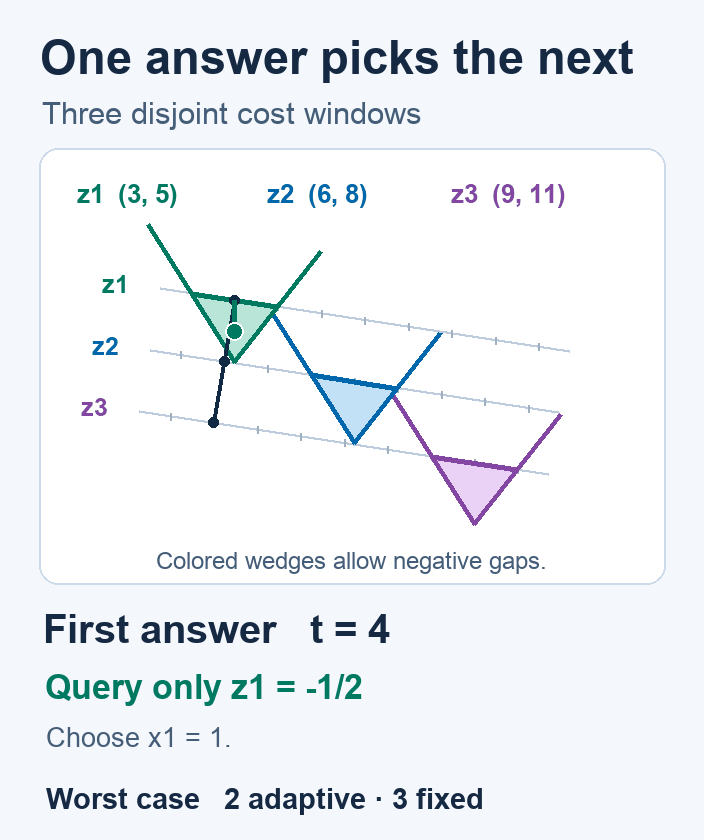

# Exact adaptive queries for pointwise decision sufficiency

  

Given a rational linear program and an open rational prior on its costs, real quantifier elimination computes the exact minimum worst-case number of adaptive linear queries needed to return a common optimizer. It can also construct an optimal deterministic semialgebraic policy. For every m ≥ 2, a nondegenerate cube needs two adaptive queries and m fixed queries. The gap also occurs with a bounded open rational box of costs.

[Read the paper](paper/manuscript.pdf) · [LaTeX source](paper/manuscript.tex) · [Proof outline](proof/PROBLEM_AND_PROOF.md) · [Run the replay](REPRODUCIBILITY.md)

## One answer picks the next

In the worked example, measuring t = 7 singles out the middle interval (6, 8). Only z2 can be negative, so the second query measures z2. The other two gaps stay positive. At t = 5, every gap is positive and no second query is needed. A fixed dataset must cover all three possible sign changes.

[Download the offline explorer](https://raw.githubusercontent.com/DannyExperiments/adaptive-pointwise-decision-queries/refs/tags/v1.0.0/visualization/adaptive-cost-windows-explorer.zip), extract it, and open index.html to rotate the plot and try other answers. [Figure guide](visualization/README.md)

## Sources and verification

The deployment-time question is in [Ye, Amin and Özdağlar, COLT 2026, §7, p. 13](https://raw.githubusercontent.com/mlresearch/v336/main/assets/ye26a/ye26a.pdf#page=13) and [catalog Q439](https://github.com/10m-u/open-problems-catalog/blob/ca8d4d44ba3db527f19f28928c240168f545ecfe/problems/mathematics/optimization-operations-research.md#q439). The paper proves an exact algorithm without an efficient runtime claim. The finite replay covers the open polyhedron, bounded box, and bounded ellipsoid examples, including ties and interval endpoints.

[Mathematical audit](audits/public_safe_reports/MATHEMATICAL_AUDIT.md) · [Literature audit](audits/public_safe_reports/LITERATURE_AUDIT.md) · [Scope](CLAIM_SCOPE_AND_LIMITATIONS.md) · [AI disclosure](AI_DISCLOSURE.md) · [Status](STATUS.md)

[Release v1.0.0](https://github.com/DannyExperiments/adaptive-pointwise-decision-queries/releases/tag/v1.0.0) · [Version DOI](https://doi.org/10.5281/zenodo.24571145) · [Citation](CITATION.cff)
